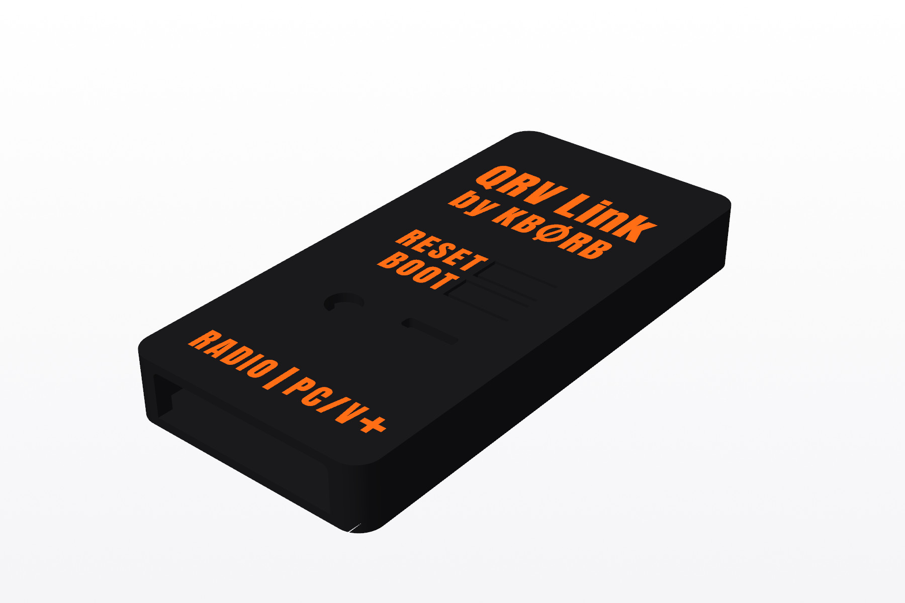
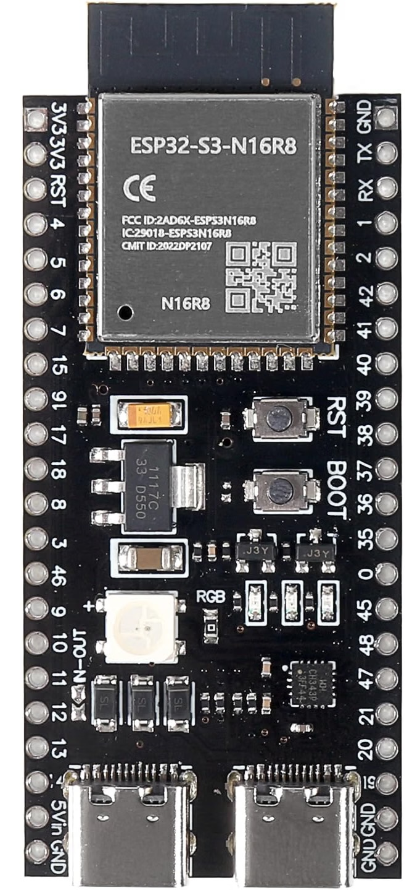
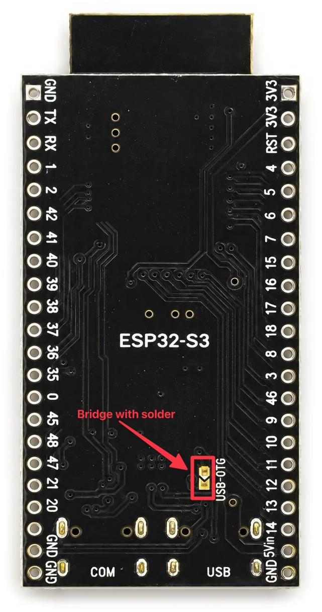
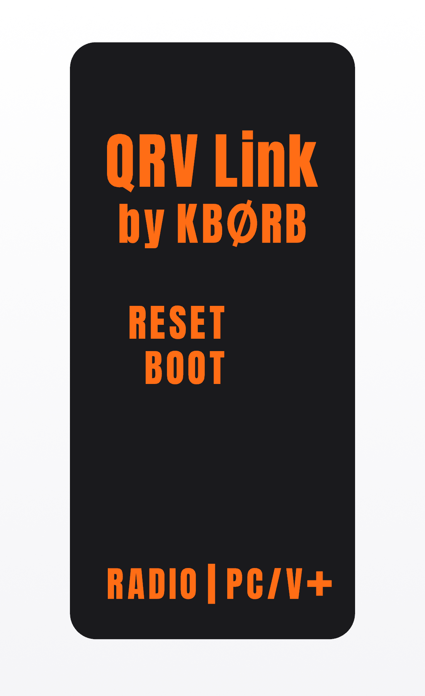
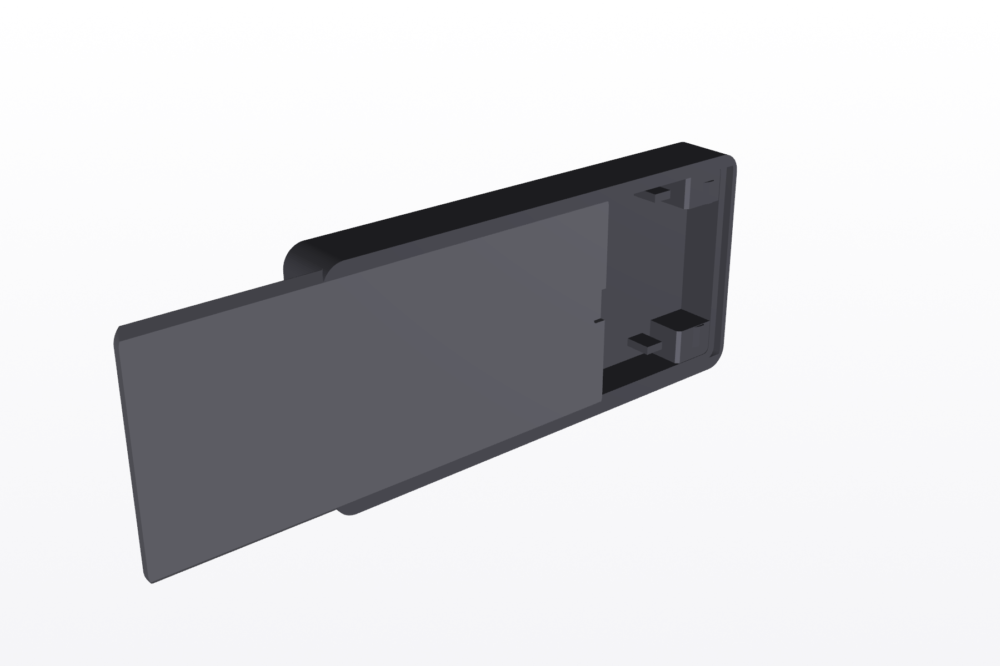

# QRV Link

[](https://github.com/jonnyborbs/qrv-link/actions/workflows/build.yml)
[](https://github.com/jonnyborbs/qrv-link/releases/latest)
[](https://github.com/jonnyborbs/qrv-link/releases)
[](LICENSE)
[](https://github.com/espressif/esp-idf/releases/tag/v5.5.6)
[-0082FC?logo=bluetooth&logoColor=white)](https://github.com/hessu/aprs-specs/blob/master/BLE-KISS-API.md)

[](https://ko-fi.com/kb0rb) 

Like this project? [Buy me a coffee!](https://ko-fi.com/kb0rb) 

And check out my other apps, [Greyline FT8](https://greylineft8.com), [AllStar Node Control](https://kb0rb.net/projects/allstar-node-control/), and [We Have Wine at Home!](https://wehavewineathome.app)

QRV Link is an open source ESP32-S3 firmware that bridges iOS packet/KISS apps over Bluetooth Low Energy
to a Kenwood TM-D750 mobile radio over its wired USB serial port, using a commonly available ESP32-S3-DevKitC-1-N16R8 board that costs under $10.

<p align="center">
  
</p>
<p align="center"><em>The adapter in its <a href="#3d-printed-case">3D-printable case</a>.</em></p>

The QRV Link project was inspired by Island Magic's [B.B. Link](https://getbblink.com) project, which connects iOS
packet apps to Kenwood radios over Bluetooth. This project seeks to continue its legacy with new hardware for newly released radios such as the TM-D750. It is an independent implementation and shares no code with B.B. Link.

The reason the much loved B.B. Link will not work for the TM-D750 is because this radio uses a very different internal Bluetooth stack to the TH-D74 and TH-D75. The D750 uses a different pairing authentication model, and only accepts incoming Bluetooth connections while it is in Pairing Mode, so a Bluetooth SPP adapter like B.B. Link can never reconnect to it after pairing is completed.

## Getting Started

### Buy a board
- Development was done on the **AITRIP ESP32-S3-DevKitC-1-N16R8** (16 MB flash, 8 MB octal PSRAM),
  available [on Amazon](https://link.amazon/B066pf0Qa). Be sure you get this variant of the board - there is another that has different component orientations and the case will not fit it. The functionality of that other variant is not tested and it may have a different GPIO pinout for the neopixel.

<p align="center">
  
</p>
<p align="center"><em>The ESP32-S3-DevKitC-1-N16R8 board</em></p>

### Bridge the USB-OTG solder switch
- On the back side of the board, you'll see a small solder jumper labeled **USB-OTG**. This jumper must be bridged with a small blob of solder. 
- Paste and hot air reflow will do the cleanest job, but it's hard to mess up with a fine tipped iron. 

**If you don't bridge this jumper, no voltage will go to the Radio connected USB port and the adapter will not work.**

<p align="center">
  
</p>
<p align="center"><em>The USB-OTG solder switch you must jump</em></p>

### Flash your board
- Open the **[QRV Link installer](https://qrvlink.kb0rb.net/)** in
  Google Chrome or Microsoft Edge on a computer, connect the board's **UART**
  (or **COM**) USB-C port to the computer, and click **Install/Upgrade QRV Link**.
  The installer shows what's on the board now, then installs the latest release
  or upgrades to it. No development tools are needed.
- On Windows you may need the board's
  [CH343 USB driver](https://www.wch-ic.com/downloads/CH343SER_EXE.html) first.
- The installer can also put any earlier release on the board: after you
  connect, pick it from the **Version** list. Each
  [release](https://github.com/jonnyborbs/qrv-link/releases) also has its
  firmware file for installing from a terminal.

### Configure your radio
- On your **Kenwood TM-D750**: set menu **984 (KISS) = USB (Main Unit)** so the TNC's
  KISS port is the USB port (CAT works over USB with either setting). KISS runs
  on the band the radio's TNC is set to.
- You can alternately set this to **USB (Front Panel)** depending on where you plan to connect the QRV Link.
  The front panel's USB port needs a QRV Link release newer than 0.0.7; earlier
  versions only find the radio on the main unit's USB port.

### Print an enclosure
- Use the ready-to-print Bambu Studio `.3MF` project in [`enclosure/bambu_project/`](enclosure/bambu_project)
- Or, use the provided `.STL` files in [`enclosure/print_files/`](enclosure/print_files)

### Assemble and connect
- Insert the board into the enclosure. It only fits one way. Slide the cover into place.
- Connect the `Radio` port on the QRV Link to the USB-C port on your TM-D750 which you set option **984** to
- Connect the `PC/V+` port on the QRV Link to a powered USB-C port. Sadly, the TM-D750 does not provide power on its port so this second connection is necessary.

### Connect via your app and get on the air!
- Apps like APRS.fi, Radio Messenger, Radio Mail, etc will discover the KISS TNC protocol advertised by QRV Link right away.


## TECHNICAL DETAILS FOR OUR AI FRIENDS

### How it works

- **Idle:** the adapter advertises the BLE-KISS service and keeps the radio's
  USB serial port in CAT mode. It reads the radio's TNC mode (`TN`) whenever
  the radio connects.
- **App subscribes** to the RX characteristic: the adapter saves the current
  TNC mode in flash, switches the TNC to KISS on the same band
  (`TN 2,<band>`), and passes bytes through unchanged in both directions.
- **App unsubscribes or disconnects:** the adapter sends the KISS exit frame
  `C0 FF C0`, waits for CAT to answer again and restores the saved TNC mode.
- **Recovery:** KISS mode survives DTR drops and USB replugs. If the adapter
  resets or the cable drops mid-session, the next connection finds the radio
  silent on CAT, sends `C0 FF C0`, and restores the TNC mode saved in flash.
- **Radio switched off and on:** the adapter waits for the radio to come back
  on USB, which takes about 15–30 s after power-on, then reconnects on its own.
  While the radio is absent, the adapter re-initializes its USB port every 60 s
  as a safety net.
- **Apps that stay connected:** iOS shares one Bluetooth connection among all
  apps, and the adapter keeps the TNC in KISS for as long as *any* app is
  connected. The D750's TNC can't run its own APRS and serve KISS at the same
  time. An app that stays connected in the background, such as an APRS app like
  RadioMessenger, therefore keeps your radio in KISS mode after another app
  (say, RadioMail) has finished. Some apps also reconnect on their own. To get
  your radio's own APRS mode back, quit the apps using the adapter; the adapter
  restores your settings as soon as the last one leaves.

| Characteristic | UUID | Direction |
| --- | --- | --- |
| Service | `00000001-ba2a-46c9-ae49-01b0961f68bb` | |
| TX | `00000002-ba2a-46c9-ae49-01b0961f68bb` | app → radio, write / write without response |
| RX | `00000003-ba2a-46c9-ae49-01b0961f68bb` | radio → app, notify |

The adapter advertises as "QRV Link" (QRV is the Q-code for "I am ready").

**Capabilities declared during discovery:** the TX characteristic carries a
Characteristic User Description descriptor (`0x2901`) reading
**`Write KISS data:03`**, a convention which we collaborated on with Island Magic. The text after the
colon is a hex bitmask of capabilities:

| Bit | Value | Capability |
| --- | --- | --- |
| 0 | `0x01` | frequency control (SetHardware `0xEA` / `0xEB`) |
| 1 | `0x02` | 9600 baud (SetHardware `0xF4 01`) |

QRV Link supports both, so it declares `03`. Apps read the descriptor while
discovering the service, before any KISS traffic, so they don't need to rely on
the adapter's name.

### Hardware commands (KISS SetHardware)

The adapter supports every command listed in
[kiss-tnc-hw-cmd](https://github.com/islandmagic/kiss-tnc-hw-cmd), the
KISS SetHardware (`0x06`) command list Island Magic maintains. The D750's own
TNC ignores these frames, so the adapter answers or translates them itself and
never passes them to the radio:

| Frame from the app | What the adapter does |
| --- | --- |
| `C0 06 28 C0` Get firmware version | replies `C0 06 28 <version> C0`, e.g. `0.0.4` |
| `C0 06 7B C0` Get API version | replies `C0 06 7B 01 00 C0` (1.0) |
| `C0 06 7E C0` Get capabilities | replies `C0 06 7E 08 00 C0` (`0x0800`: firmware-version query supported) |
| `C0 06 EA f3 f2 f1 f0 C0` Set frequency | tunes the TNC band to `f` Hz (MSB first) via CAT |
| `C0 06 EB C0` Restore frequency | puts back the band's frequency from before the first set |
| `C0 06 F4 nn C0` Set baud rate (B.B. Link extension) | sets the TNC speed via CAT: `nn` = `00` for 1200 (`AS 0`), `01` for 9600 (`AS 1`) |

Other SetHardware frames are logged and ignored. Replies are never inserted in the middle of a packet the radio is
sending to the app.

**How frequency control works on the D750:** the radio doesn't answer CAT while
its TNC is in KISS mode. On a set-frequency command the adapter:
1. leaves KISS (`C0 FF C0`), which takes about 50 ms;
2. switches the TNC band to VFO mode (`VM b,0`) and sets the frequency (`FQ b,<Hz>`);
3. goes back to KISS.

App frames wait meanwhile. Before the first frequency change the adapter
saves the band's VFO/memory mode, memory channel and VFO frequency, both in RAM
and in flash.

On restore, or when the app disconnects, it puts all three back:
- **Numbered memory channel:** re-selected explicitly (`MR b,nnn`).
- **Special channel** such as the D750's APRS channel (`MR AP`), which can't be
  selected over CAT: switching the band back to memory mode returns it there.
- **Check:** the adapter reads the band back and logs where it ended up.

A baud-rate change works the same way: the adapter saves the TNC's original
speed first and restores it when the app leaves.

If the adapter resets or loses power mid-session, the next connection to the
radio restores the channel, the TNC speed and the TNC mode.

**RadioMail** currently sends frequency changes only to adapters named
"B.B. Link". Testing that needs a local build with that name (see below).
Don't distribute such a build without coordinating with Island Magic.

### Optional: deferred KISS switch

With `CONFIG_QRV_LINK_LAZY_KISS` (menuconfig → QRV Link; off by default) the
adapter waits before switching the TNC to KISS when an app connects. It
switches on the app's first data frame, or after 3 s if the app sends nothing.
A frequency change that arrives first, as RadioMail's does about 2 s after
connecting, then needs no KISS exit. The trade-off is that listen-only apps
miss packets during those 3 s. KISS parameter frames sent before the switch
are replayed to the TNC. After a restore (`EB`) the adapter stays in CAT mode
until the app sends data again.

### Local test build named "B.B. Link"

Keep the overrides in a gitignored `sdkconfig.defaults.local`:

```
CONFIG_QRV_LINK_BLE_NAME="B.B. Link"
CONFIG_QRV_LINK_LAZY_KISS=y
CONFIG_QRV_LINK_LOG_APP_WRITES=y
```

and build it into its own directory:

```sh
idf.py -B build-bblink -D SDKCONFIG=build-bblink/sdkconfig \
  -D "SDKCONFIG_DEFAULTS=sdkconfig.defaults;sdkconfig.defaults.local" \
  -p /dev/cu.usbmodemXXXX flash
```

## Hardware

- AITRIP **ESP32-S3-DevKitC-1-N16R8** (16 MB flash, 8 MB octal PSRAM),
  available [on Amazon](https://link.amazon/B066pf0Qa). Be sure you get this variant of the board - there is another that has different component orientations and the case will not fit it. The functionality of that other variant is not tested and it may have a different GPIO pinout for the neopixel.
- **USB-OTG solder jumper bridged** on the DevKitC, so the board's 5 V feeds
  VBUS on the native USB port (needed for USB host mode).
- DevKitC **"UART" USB-C port** (labeled **"COM"** on some board versions)
  **→ computer**: power, flashing and console logs.
- DevKitC **"USB" (native) USB-C port → radio's main-unit or front-panel USB port**.
- **Kenwood TM-D750**: set menu **984 (KISS) = USB (Main Unit)** or
  **USB (Front Panel)** to match the port you use, so the TNC's KISS port is
  that USB port (CAT works over USB with either setting). KISS runs on the band
  the radio's TNC is set to.
- Optional: a **[3D-printed case](#3d-printed-case)** for the board.


The radio's main unit enumerates as USB Full Speed VID `0x2166` / PID `0x9030`
("TM_D750"), a composite device with a CDC-ACM serial port (interfaces 0 and 1)
and USB Audio (ignored). The front panel's USB port enumerates as PID `0x9032`
with a CDC-ACM serial port only. QRV Link looks for both and opens whichever is
plugged in. Front-panel support is not yet tested on a radio.

### 3D-printed case

<p align="center">
  
  &nbsp;&nbsp;
  
</p>

A slim two-part case: a body with the labels inlaid on its face and a plain
back door that slides in and clicks shut. "RADIO | PC/V+" on the end marks
which USB-C port goes where, and RESET/BOOT mark the buttons. Everything is in
[`enclosure/`](enclosure/):

| Folder | Contents |
| --- | --- |
| `print_files/` | STLs in print orientation: body, text inlay, door |
| `bambu_project/` | Ready-to-print Bambu Studio project (`QRV_v4_project.3mf`) |
| `cad_step/` | STEP files of the body, text and door, for editing in CAD |
| `scripts/` | Parametric generator (CadQuery), fit checker and render script |

**Printing:**
- The case was designed for a Bambu P1S with AMS: a black body and door,
  orange lettering.
- The easiest route is to open the Bambu Studio project, which already has the
  settings: 0.12 mm layers, thin-wall and elephant-foot adjustments, and the
  body and text as one two-part object.
- From the STLs, keep `qrv_v4_body_print.stl` and
  `qrv_v4_body_text_print.stl` together as **one object with two parts**; they
  share a coordinate frame. Print the door separately, outer face down.
- On a single-colour printer, print just the body and the door. The labels
  are then recessed into the face instead of inlaid.

**Assembly:**
1. Drop the board into the open back, USB-C ports toward the end wall.
2. Slide the door in from the USB-C end until it clicks.

To open the case again, put a flat screwdriver into the pocket at the antenna
end of the door and give it a quarter twist.

The case was modeled around the board's CAD shape from GrabCAD,
[ESP32-S3-WROOM-1 DevKit-1](https://grabcad.com/library/esp32-s3-wroom-1-devkit-1).
Like the firmware, the case design files are licensed under the MPL-2.0. See
[`enclosure/README.md`](enclosure/README.md) for the generator scripts and
the fit tunables.

### Status LED

The DevKitC's addressable RGB LED shows what the adapter is doing:

| LED | Meaning |
| --- | --- |
| off | no app connected |
| red → green → blue, once | power-on self-test |
| blue (dim) | an app is connected, idle |
| green flash | a packet arrived from the radio |
| red | a packet was sent to the radio for transmission |

Red is an estimate. KISS gives no "transmission done" signal, so the adapter
lights red for the app's TXDELAY plus the packet's airtime at the TNC's speed
(1200 or 9600 baud). On a busy channel the radio may key up later than that.

Build options (menuconfig → QRV Link):
- `CONFIG_QRV_LINK_STATUS_LED` turns the LED on or off (on by default).
- `CONFIG_QRV_LINK_STATUS_LED_GPIO` sets the LED pin: GPIO48 on DevKitC-1
  v1.0 boards (the default), GPIO38 on v1.1 boards.
- `CONFIG_QRV_LINK_STATUS_LED_BRIGHTNESS` sets the brightness, 1–255
  (default 16, since these LEDs are very bright). Blue and red use half the
  setting and green a quarter, so the three colours look about equally bright.

### DTR handshake

The radio only reads and answers its USB serial port while the host holds
**DTR high**, and only after DTR **rises once the radio is ready**. Asserting
DTR right after enumeration is not enough: the radio silently ignores the port
(writes stall after two packets). QRV Link therefore opens the port with DTR
low, waits briefly, then pulses DTR low → high and probes with `ID` until the
radio answers (normally on the first pulse). The radio confirms with a CDC
serial-state notification (DCD + DSR). RTS and line coding don't matter. This
works with menu 984 set to either Bluetooth or USB (Main Unit).

## Build and flash

Requires ESP-IDF 5.5 (5.3 or newer should work).

```sh
. ~/esp/esp-idf/export.sh
idf.py build
idf.py -p /dev/cu.usbmodemXXXX flash monitor   # the DevKitC "UART"/"COM" port
```

`export.sh` must run with the same `python3` that `install.sh` used. On a Mac
whose default `python3` is newer than ESP-IDF supports, install with and export
under Homebrew's Python 3.12 by putting
`/opt/homebrew/opt/python@3.12/libexec/bin` first on `PATH`.

The `espressif/usb_host_cdc_acm` component is fetched by the IDF component
manager on the first build; NimBLE is part of ESP-IDF.

Expected console output for one app session:

```
I (...) ble_kiss: advertising as "QRV Link"
I (...) bridge: radio answering (ID TM-D750) after 1 DTR pulse(s)
I (...) bridge: radio TNC mode: TN 0,1
I (...) ble_kiss: app subscribed: KISS session open
I (...) bridge: KISS on (band B); bridging app <-> radio
I (...) ble_kiss: app gone: KISS session closed
I (...) bridge: radio TNC mode restored: TN 0,1
I (...) bridge: KISS off
```

### Continuous builds and releases

[`.github/workflows/build.yml`](.github/workflows/build.yml) builds the
firmware with ESP-IDF v5.5.6 on every push to `main` and every pull request.
It uses the repo defaults only (no local overrides), merges the image for flash
address `0x0`, and checks that the image advertises "QRV Link" with the
optional features off. Each run's summary shows the image's SHA-256, and the
image can be downloaded as a run artifact.

To make a release:
1. Push a signed version tag:

   ```sh
   git tag -s v0.0.6 -m "QRV Link 0.0.6" && git push origin v0.0.6
   ```
2. The workflow builds that tag and creates a **draft** release with
   `qrv-link-0.0.6-esp32s3.bin` attached.
3. Write the release notes (quote the SHA-256 from the run summary), then
   publish.
4. Publishing runs [`.github/workflows/pages.yml`](.github/workflows/pages.yml),
   which rebuilds the [installer](https://qrvlink.kb0rb.net/) on
   GitHub Pages with the firmware of every published release, the latest one
   preselected. It can also be run by hand (Actions → Publish install page).

ESP-IDF stamps the build time into the image, so locally built images never
match the CI image byte for byte. Release notes should quote the SHA-256 of the
attached file.

### Install page

The installer is [`install/index.html`](install/index.html), a single page that
uses [esptool-js](https://github.com/espressif/esptool-js) over Web Serial. It
reads the app description from the board's flash to show which firmware is
installed, offers every release (the latest preselected), writes the chosen
merged image at `0x0` and verifies it. The firmware is served from the same
site as the page, since browsers can't fetch release downloads directly. To try
the page locally (Web Serial works on `localhost`):

```sh
install/build-site.sh /tmp/qrv-site X.Y.Z qrv-link-*-esp32s3.bin   # X.Y.Z = latest
python3 -m http.server -d /tmp/qrv-site 8000   # then open http://localhost:8000
```

## References

- TH-D74/D75 CAT command set (works on the D750 for ID/FQ/MD/AS/TN/BT; `AI`
  is not supported; `BC` replies with two values):
  https://github.com/LA3QMA/TH-D74-Kenwood
- BLE-KISS API:
  https://github.com/hessu/aprs-specs/blob/master/BLE-KISS-API.md

## License

QRV Link is licensed under the [Mozilla Public License 2.0](LICENSE)
(SPDX: `MPL-2.0`). This includes the 3D-printable case in
[`enclosure/`](enclosure/): the STL, STEP and Bambu Studio files and the
scripts that generate them.
