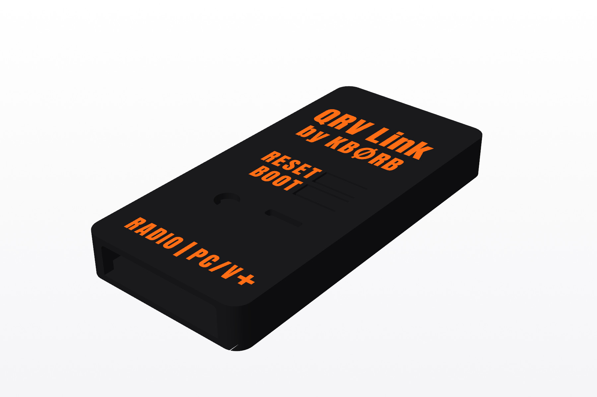
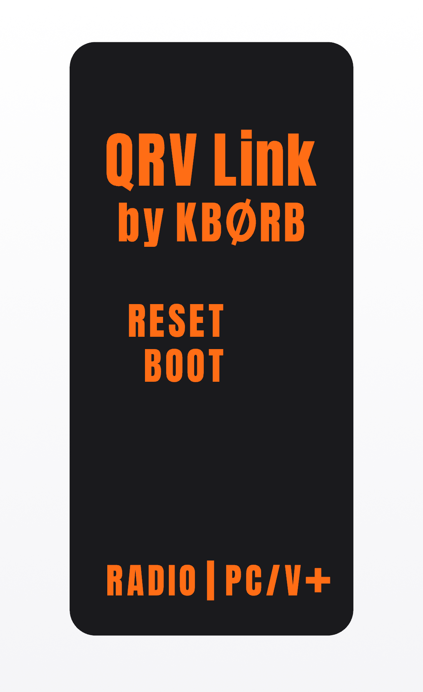
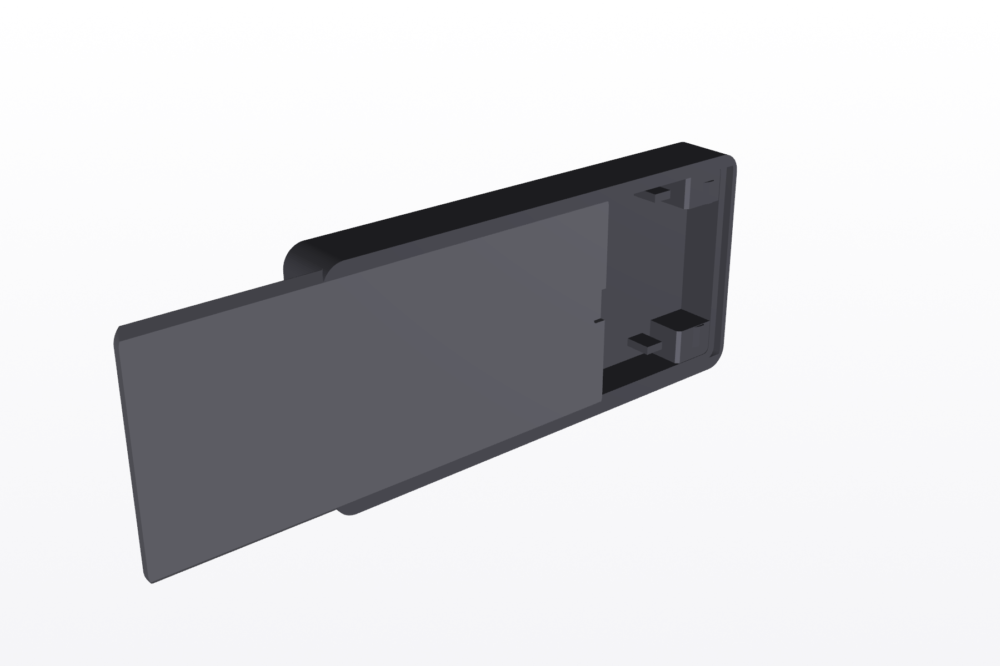

# QRV Link case, v4

Slim two-part sliding case for the **AITRIP ESP32-S3-DevKitC-1 N16R8 (dual USB-C)**: a front body and a plain back door. Designed for a Bambu P1S with AMS (black case, orange text).



<p align="center">
  
  &nbsp;&nbsp;
  
</p>

*Rendered directly from the print STLs: front face with the labels (left) and the back with the door slid partway out (right).*

## Contents

| Folder | What's in it |
| --- | --- |
| `print_files/` | STLs in print orientation |
| `cad_step/` | STEP versions of the body, text and door |
| `bambu_project/` | `QRV_v4_project.3mf`: Bambu Studio project with layer height 0.12, object overrides (thin walls, elephant-foot 0.1, Arachne), body and text as one multi-part object, door separate |
| `images/` | Renders of the finished case (made from the print STLs) |
| `scripts/` | Parametric generator, fit checker, 3MF patch helper and render script |

### Print files

| File | Part | Filament |
| --- | --- | --- |
| `qrv_v4_body_print.stl` | Case body, front face down, text pockets cut in | black (2) |
| `qrv_v4_body_text_print.stl` | Text inlay for the pockets | orange (1) |
| `qrv_v4_door_print.stl` | Sliding back door, outer face down | black (2) |

Keep the body and text together as **one object with two parts**; they share a coordinate frame.

## Assembly

1. Drop the board into the open back, USB-C ports toward the end wall.
2. Slide the door in from the USB-C end until the detents click.

**Removal:** put a flat screwdriver straight down into the pocket at the antenna end of the door and give it a quarter twist. It braces on the body's rear wall and pushes the door toward the USB-C end until the detents let go.

## Scripts

```sh
python3 scripts/esp32s3_case_v4.py <outdir>     # regenerate STLs and STEP files
python3 scripts/verify4.py <board.step>         # board/body/door clearance and door slide-in sweep
python3 scripts/patch3mf.py <meshdir> <in.3mf> <out.3mf>   # swap new meshes into the Bambu project, keeping its settings
python3 scripts/render_v4.py <print_files_dir> <outdir>    # render the images (needs VTK)
```

Requires CadQuery, trimesh, manifold3d and the Anton font (see `TEXT_FONT` in the generator). `verify4.py` also needs the board's STEP file.

## Tunables

Set at the top of `esp32s3_case_v4.py`:

| Parameter | Controls |
| --- | --- |
| `DETENT_H` | Latch strength (door click) |
| `PORT_W` | Size of the "RADIO \| PC/V+" labels |
| `PRY_W`, `PRY_DEPTH`, `PRY_Z` | Screwdriver pocket in the door |
| `PLUNGER_GAP` | Button nub travel |
| `FIT_FRONT`, `FIT_REAR` | Door tightness |
